# Практична робота № 8

## Моделювання зв'язків між сутностями та керування міграціями

**Виконав:** Олійник Артем Сергійович
**Курс:** IV
**Група:** КН-43
**Дисципліна:** WEB-розробка
**Варіант:** 7 (автозапчастини, `AutoPartEntity`)
**Рік:** 2026

---

## Мета роботи

- Опанувати принципи моделювання реляційних зв'язків між сутностями (`One-to-One`, `One-to-Many` / `Many-to-One`, `Many-to-Many`) в ORM TypeORM.
- Навчитися налаштовувати каскадні операції збереження та видалення (`cascade`, `onDelete`).
- Опанувати конфігурування TypeORM CLI та `DataSource` для версіонування схеми бази даних через міграції.
- Навчитися генерувати, застосовувати та відкочувати міграції (`migration:generate`, `migration:run`, `migration:revert`).
- Освоїти побудову комплексних вибірок даних за допомогою `QueryBuilder` з об'єднанням зв'язаних таблиць.
- Навчитися забезпечувати атомарність операцій збереження взаємопов'язаних сутностей засобами транзакцій (`DataSource.transaction`).

## Середовище виконання

| Компонент | Версія |
|---|---|
| Node.js | 26.9.0 |
| NestJS | 12 |
| TypeORM | 1.1.2 |
| PostgreSQL | 16.15 (контейнер `postgres:16-alpine`) |
| Docker | 29.9.2 |
| ОС | macOS 27.0.1 |
| Редактор | Visual Studio Code |

## Предметна область варіанта

| Роль | Сутність | Зв'язок |
|---|---|---|
| Базова сутність | `AutoPartEntity` (автозапчастини) | - |
| Довідник | `CarModelEntity` (сумісна модель авто) | Many-to-One / One-to-Many |
| Характеристики | `SpecificationEntity` (вузли та агрегати) | Many-to-Many |
| Деталі | `CompatibilityCodeEntity` (OEM-код сумісності) | One-to-One |

## Структура проєкту

```text
web_Practichna_08/
├── src/
│   ├── auto-parts/
│   │   ├── dto/
│   │   │   ├── create-auto-part.dto.ts
│   │   │   ├── create-auto-part-transactional.dto.ts
│   │   │   ├── create-car-model.dto.ts
│   │   │   ├── create-specification.dto.ts
│   │   │   ├── pagination-query.dto.ts
│   │   │   ├── update-auto-part.dto.ts
│   │   │   └── update-auto-part-transactional.dto.ts
│   │   ├── entities/
│   │   │   ├── auto-part.entity.ts
│   │   │   ├── car-model.entity.ts
│   │   │   ├── compatibility-code.entity.ts
│   │   │   └── specification.entity.ts
│   │   ├── auto-parts.controller.ts
│   │   ├── auto-parts.module.ts
│   │   ├── auto-parts.service.ts
│   │   ├── auto-parts.service.spec.ts
│   │   ├── catalog.controller.ts
│   │   └── catalog.service.ts
│   ├── database/
│   │   ├── data-source.ts
│   │   └── migrations/
│   │       ├── 1794213092875-InitAutoPartsAndCarModels.ts
│   │       ├── 1794213185025-AddSpecificationsManyToMany.ts
│   │       └── 1794213418559-AddCompatibilityCodesOneToOne.ts
│   ├── common/
│   ├── orders/
│   ├── shared/
│   ├── app.module.ts
│   └── main.ts
├── docker-compose.yml
├── requests.http
├── .env.example
├── screenshots/
├── package.json
└── README.md
```

---

## Хід виконання

### Рівень 1. Data Source, відмова від автоматичної синхронізації та зв'язок 1:M

Схему бази тепер описують міграції, тому автоматичну синхронізацію вимкнено в конфігурації застосунку:

```ts
TypeOrmModule.forRoot({
  type: 'postgres',
  host: process.env.DB_HOST ?? 'localhost',
  port: Number(process.env.DB_PORT ?? 5432),
  username: process.env.DB_USER ?? 'postgres',
  password: process.env.DB_PASSWORD ?? 'postgres',
  database: process.env.DB_NAME ?? 'auto_parts',
  autoLoadEntities: true,
  synchronize: false,
  logging: ['error', 'warn'],
});
```

Окреме джерело даних для CLI працює зі скомпільованими файлами каталогу `dist`. Проєкт побудований на ESM, тому TypeORM CLI не може напряму завантажити TypeScript-файли з декораторами, а попередня збірка дає коректні метадані сутностей:

```ts
export default new DataSource({
  type: 'postgres',
  host: process.env.DB_HOST ?? 'localhost',
  port: Number(process.env.DB_PORT ?? 5432),
  username: process.env.DB_USER ?? 'postgres',
  password: process.env.DB_PASSWORD ?? 'postgres',
  database: process.env.DB_NAME ?? 'auto_parts',
  entities: ['dist/**/*.entity.js'],
  migrations: ['dist/database/migrations/*.js'],
  synchronize: false,
  logging: ['schema'],
});
```

Команди додано в `package.json`. Кожна з них спершу збирає проєкт, а далі викликає CLI з готовим джерелом даних:

```json
"typeorm": "node ./node_modules/typeorm/cli.js",
"migration:generate": "npm run build && npm run typeorm -- migration:generate -d dist/database/data-source.js",
"migration:run": "npm run build && npm run typeorm -- migration:run -d dist/database/data-source.js",
"migration:revert": "npm run build && npm run typeorm -- migration:revert -d dist/database/data-source.js",
"migration:show": "npm run build && npm run typeorm -- migration:show -d dist/database/data-source.js"
```

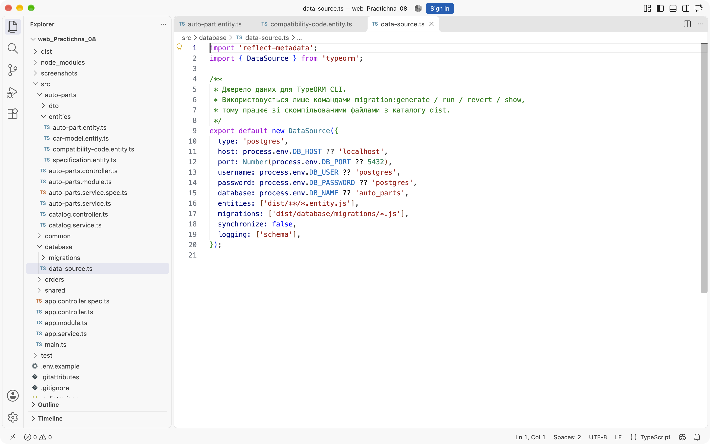

Довідник моделей авто містить унікальний індекс за маркою, назвою та початковим роком випуску:

```ts
@Entity('car_models')
@Index('uq_car_models_brand_name_year', ['brand', 'name', 'yearFrom'], {
  unique: true,
})
export class CarModelEntity {
  @PrimaryGeneratedColumn('uuid')
  id!: string;

  @Column({ type: 'varchar', length: 100 })
  name!: string;

  @Column({ type: 'varchar', length: 80 })
  brand!: string;

  @Column({ type: 'smallint', name: 'year_from' })
  yearFrom!: number;

  @Column({ type: 'smallint', name: 'year_to', nullable: true })
  yearTo!: number | null;

  @OneToMany(() => AutoPartEntity, (part) => part.carModel)
  autoParts!: AutoPartEntity[];
}
```

На боці запчастини стоїть `@ManyToOne()` з зовнішнім ключем `car_model_id`. Поле обов'язкове, а видалення моделі каскадно прибирає її запчастини:

```ts
@ManyToOne(() => CarModelEntity, (model) => model.autoParts, {
  onDelete: 'CASCADE',
  nullable: false,
})
@JoinColumn({ name: 'car_model_id' })
carModel!: CarModelEntity;
```

Початкову міграцію згенеровано порівнянням сутностей зі схемою порожньої бази:

```bash
npm run migration:generate -- src/database/migrations/InitAutoPartsAndCarModels
npm run migration:run
```

У результаті створено таблиці `car_models` і `auto_parts`, enum `auto_parts_condition_enum`, унікальні індекси та зовнішній ключ з `ON DELETE CASCADE`. Запит `migration:show` показує три застосовані міграції, а `\dt` - шість таблиць разом із службовою `migrations`:

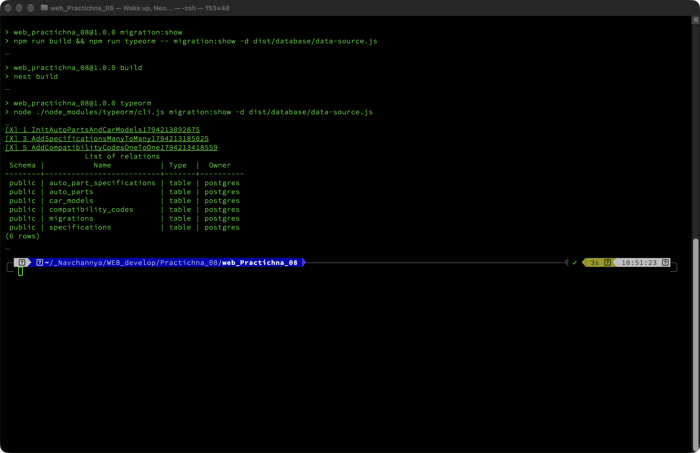

Для отримання запчастини разом зі зв'язаною моделлю використано опцію `relations`. У TypeORM 1.x вона приймає об'єкт, а не масив рядків:

```ts
const item = await this.autoPartsRepo.findOne({
  where: { id },
  relations: {
    carModel: true,
    specifications: true,
    compatibilityCode: true,
  },
});
```

Ендпоінт `GET /auto-parts/:id` повертає вкладений об'єкт `carModel` з маркою, назвою та роками випуску. Якщо запис відсутній, сервіс кидає `NotFoundException` з кодом 404.

### Рівень 2. Зв'язок Many-to-Many, таблиця зв'язку та фільтрація

Вузли та агрегати зберігаються в довіднику `specifications`. Назва унікальна, тому один вузол не дублюється для різних запчастин:

```ts
@Entity('specifications')
export class SpecificationEntity {
  @PrimaryGeneratedColumn('uuid')
  id!: string;

  @Column({ type: 'varchar', length: 100, unique: true })
  name!: string;

  @Column({ type: 'text', nullable: true })
  description!: string | null;

  @ManyToMany(() => AutoPartEntity, (part) => part.specifications)
  autoParts!: AutoPartEntity[];
}
```

На боці запчастини додано `@ManyToMany()` з `cascade: true` та явну проміжну таблицю. Каскад дозволяє зберегти новий вузол разом із запчастиною одним викликом `save()`:

```ts
@ManyToMany(() => SpecificationEntity, (specification) => specification.autoParts, {
  cascade: true,
})
@JoinTable({
  name: 'auto_part_specifications',
  joinColumn: { name: 'auto_part_id', referencedColumnName: 'id' },
  inverseJoinColumn: {
    name: 'specification_id',
    referencedColumnName: 'id',
  },
})
specifications!: SpecificationEntity[];
```

Другу міграцію згенеровано після додавання сутності та декораторів:

```bash
npm run migration:generate -- src/database/migrations/AddSpecificationsManyToMany
npm run migration:run
```

Міграція створює `specifications`, проміжну `auto_part_specifications` зі складеним первинним ключем `(auto_part_id, specification_id)`, два індекси та зовнішні ключі з `ON DELETE CASCADE`.

Життєвий цикл перевірено відкатом останньої застосованої міграції. Після `migration:revert` таблиця `compatibility_codes` зникла, у базі залишилося п'ять таблиць:

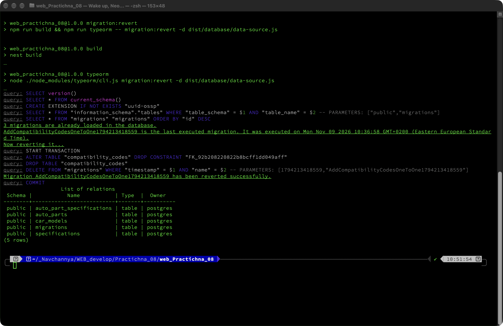

Повторний `migration:run` створив таблицю заново, а `migration:show` підтвердив, що всі три міграції застосовані:

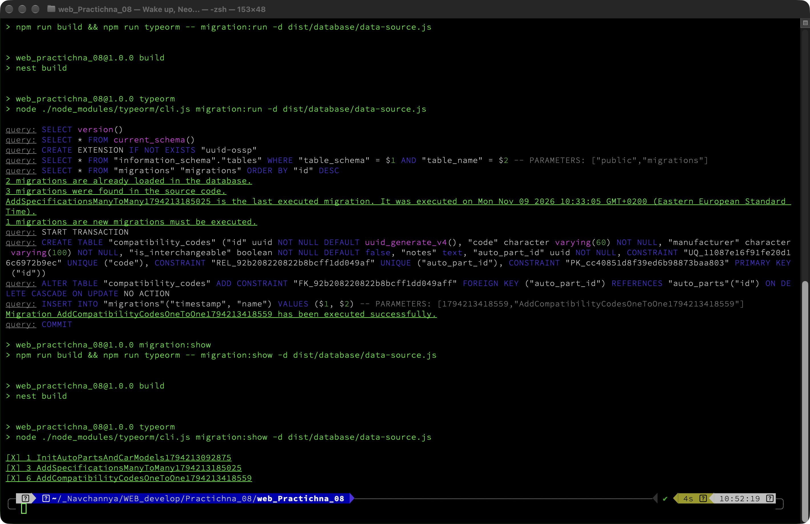

Фільтрацію за вузлом реалізовано через `QueryBuilder` з `innerJoinAndSelect`, параметризованим `where` та `distinct`, щоб пагінація не дублювала записи через зв'язок M:N:

```ts
if (specification) {
  qb.innerJoinAndSelect(
    'part.specifications',
    'specification',
    'specification.name ILIKE :specification',
    { specification: `%${specification}%` },
  ).distinct(true);
} else {
  qb.leftJoinAndSelect('part.specifications', 'specification');
}
```

Фільтр за моделлю авто додає умову за маркою або назвою через `leftJoinAndSelect` і `andWhere`. У відповіді `GET /auto-parts?specification=Гальмівна` отримано дві запчастини, а `GET /auto-parts?carModel=Toyota` - теж дві, обидва запити повернули `total: 2`:

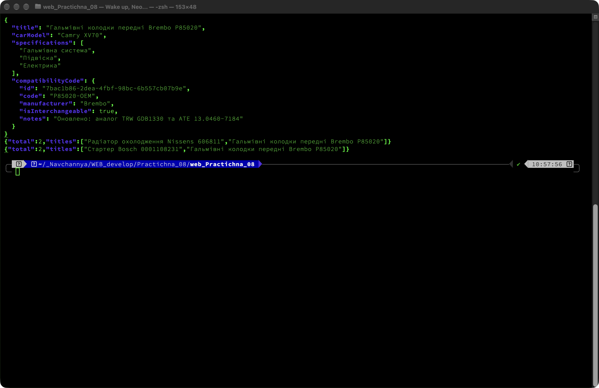

### Рівень 3. Зв'язок One-to-One, транзакції та повний агрегат

OEM-код винесено в окрему сутність `CompatibilityCodeEntity`. Володіючою стороною зв'язку є саме вона, тому `@JoinColumn()` стоїть тут, а колонка `auto_part_id` отримує унікальне обмеження. Це гарантує рівно один код на запчастину:

```ts
@Entity('compatibility_codes')
export class CompatibilityCodeEntity {
  @PrimaryGeneratedColumn('uuid')
  id!: string;

  @Column({ type: 'varchar', length: 60, unique: true })
  code!: string;

  @Column({ type: 'varchar', length: 100 })
  manufacturer!: string;

  @Column({ type: 'boolean', name: 'is_interchangeable', default: false })
  isInterchangeable!: boolean;

  @OneToOne(() => AutoPartEntity, (part) => part.compatibilityCode, {
    onDelete: 'CASCADE',
    nullable: false,
  })
  @JoinColumn({ name: 'auto_part_id' })
  autoPart!: Relation<AutoPartEntity>;
}
```

Третю міграцію згенеровано командою:

```bash
npm run migration:generate -- src/database/migrations/AddCompatibilityCodesOneToOne
npm run migration:run
```

Вона створює `compatibility_codes` з унікальними `code` і `auto_part_id`, а зовнішній ключ має `ON DELETE CASCADE`. Під час проєктування виникла циклічна залежність ESM між сутностями: `emitDecoratorMetadata` намагався звернутися до класу до його ініціалізації. Тип властивості замінено на `Relation<AutoPartEntity>`, після чого метадані почали генеруватися як `Object`, і CLI успішно побудував міграцію.

Атомарне створення запчастини виконується в одній транзакції. Спочатку перевіряються модель авто та бізнес-правило для ціни, далі зберігаються сама запчастина, код сумісності та список вузлів. Якщо після цього спрацьовує штучний збій, TypeORM відкочує всю транзакцію:

```ts
return this.dataSource.transaction(async (manager) => {
  const carModel = await manager.findOneBy(CarModelEntity, {
    id: dto.carModelId,
  });
  if (!carModel) {
    throw new NotFoundException(`Модель авто з ID ${dto.carModelId} не знайдена`);
  }

  if (dto.price < 100) {
    throw new BadRequestException(
      'Ціна автозапчастини не може бути меншою за 100 грн. Транзакцію відкочено.',
    );
  }

  const savedPart = await manager.save(manager.create(AutoPartEntity, {
    title: dto.title,
    price: dto.price,
    oemCode: dto.oemCode,
    condition: dto.condition,
    carModel,
  }));

  if (dto.compatibilityCode) {
    savedPart.compatibilityCode = await manager.save(
      manager.create(CompatibilityCodeEntity, {
        code: dto.compatibilityCode.code,
        manufacturer: dto.compatibilityCode.manufacturer,
        isInterchangeable: dto.compatibilityCode.isInterchangeable ?? false,
        notes: dto.compatibilityCode.notes ?? null,
        autoPart: savedPart,
      }),
    );
  }

  savedPart.specifications = await this.resolveSpecifications(
    dto.specificationNames,
    manager,
  );
  await manager.save(savedPart);

  if (dto.simulateFailure) {
    throw new BadRequestException(
      'Штучний збій бізнес-логіки після збереження даних. Транзакцію відкочено.',
    );
  }

  return this.loadAggregate(manager, savedPart.id);
});
```

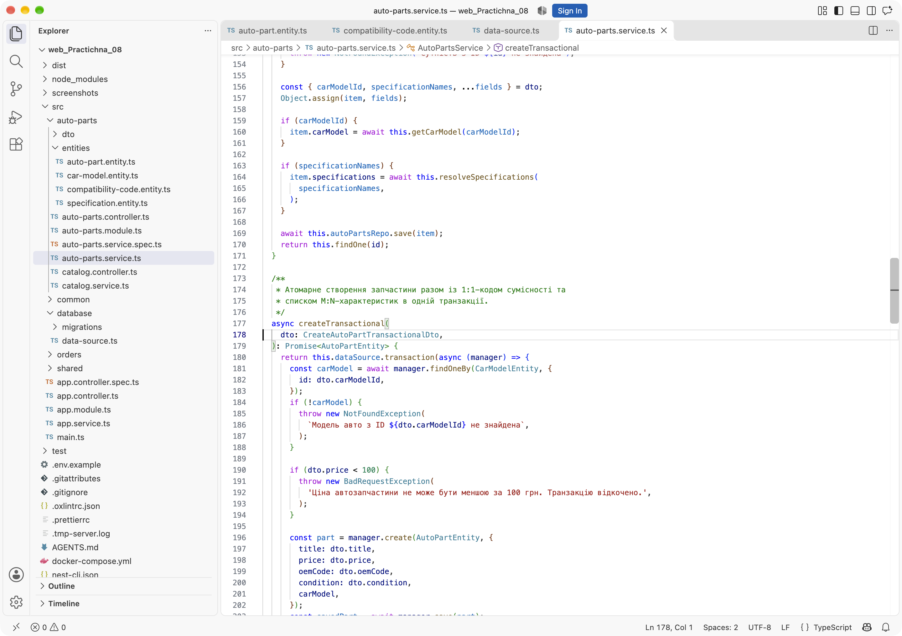

Для перевірки відкату надіслано коректний за структурою запит із прапорцем `simulateFailure: true`. Сервіс устиг зберегти запчастину, код і зв'язки, після чого кинув `BadRequestException`. Кількість рядків до і після запиту однакова: `parts = 6`, `codes = 6`, `links = 10`. Запитів із `oemCode = FAIL-DEMO-02` та кодів `FAIL-CODE-DEMO-2` у базі немає:

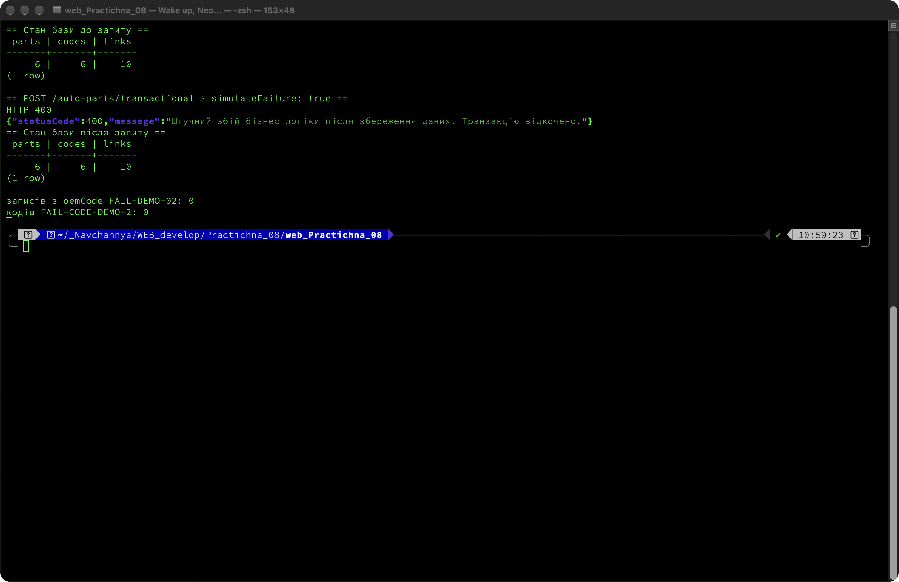

Повне оновлення агрегата виконується методом `updateTransactional`: у транзакції завантажуються всі зв'язки, змінюються поля запчастини, оновлюється або створюється код сумісності та замінюється список вузлів. За тим самим принципом працює і прапорець `simulateFailure`.

Окремий ендпоінт `GET /auto-parts/:id/aggregate` збирає повний агрегат через `QueryBuilder` і підвантажує одночасно всі три типи зв'язків:

```ts
const item = await this.autoPartsRepo
  .createQueryBuilder('part')
  .leftJoinAndSelect('part.carModel', 'carModel')
  .leftJoinAndSelect('part.specifications', 'specification')
  .leftJoinAndSelect('part.compatibilityCode', 'compatibilityCode')
  .where('part.id = :id', { id })
  .getOne();
```

Відповідь містить `carModel` (1:M), масив `specifications` (M:N) і об'єкт `compatibilityCode` (1:1). На скріншоті нижче видно всі три частини агрегата для гальмівних колодок Brembo:


Каскадне видалення перевірено на тимчасовій моделі Nissan Qashqai. Запчастина мала код сумісності та зв'язок із вузлом, тому до видалення налічувався один рядок у кожній таблиці. Після `DELETE /car-models/:id` зникли сама запчастина, її OEM-код і рядок проміжної таблиці:

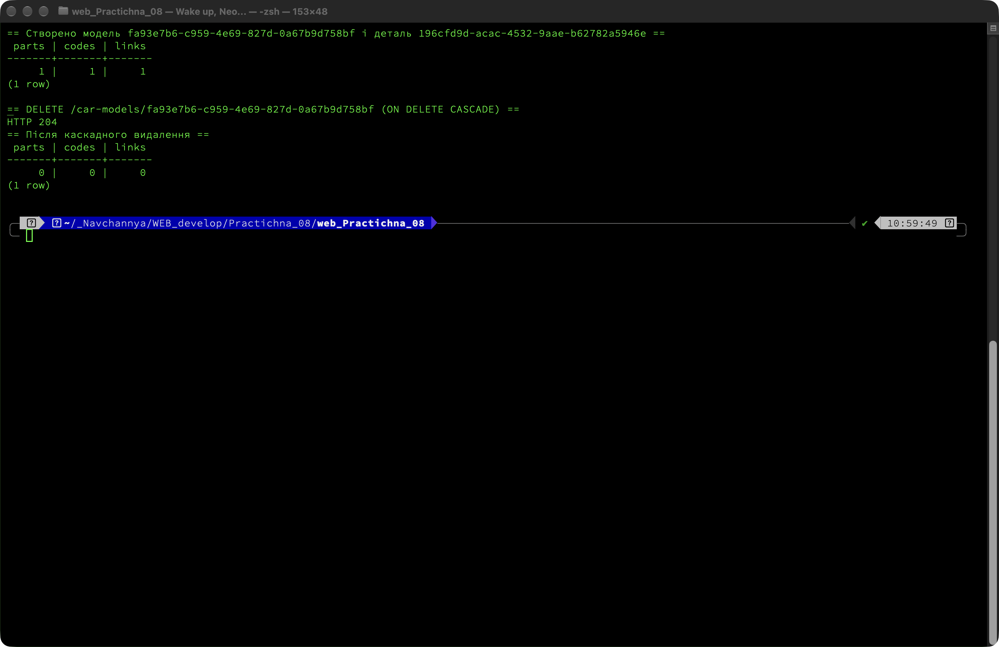

Сервер стартує без помилок і реєструє маршрути для запчастин, довідників і замовлень:

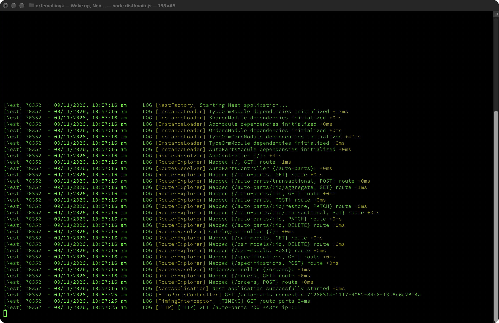

### Результати перевірки

| Перевірка | Очікування | Фактично | Результат |
|---|---|---|---|
| `synchronize` | вимкнено | `false` в `AppModule` | успішно |
| Початкова міграція | 2 таблиці та FK | `car_models`, `auto_parts`, `ON DELETE CASCADE` | успішно |
| Міграція M:N | проміжна таблиця | `auto_part_specifications`, складений PK | успішно |
| Міграція 1:1 | унікальний `auto_part_id` | `REL_...` UNIQUE, `NOT NULL` | успішно |
| Відкат міграції | таблиця зникає | 5 таблиць після `revert` | успішно |
| Повторний накат | усі міграції застосовані | `[X]` для трьох міграцій | успішно |
| Завантаження 1:M | вкладений `carModel` | `Camry XV70`, `Toyota` | успішно |
| Фільтр M:N | лише потрібні записи | 2 записи за «Гальмівна» | успішно |
| Фільтр M:1 | записи моделі | 2 записи за `Toyota` | успішно |
| Повний агрегат | 1:M + M:N + 1:1 | три зв'язки в одній відповіді | успішно |
| Відкат транзакції | жодного нового рядка | 6/6/10 до і після, 0 збігів | успішно |
| Каскадне видалення | 0/0/0 | 1/1/1 до, 0/0/0 після | успішно |
| `npm run build` | без помилок | 0 помилок | успішно |
| `npm test` | тести проходять | 4 тести, 2 файли | успішно |

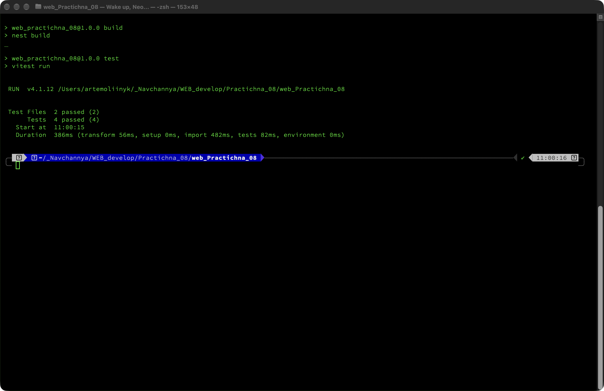

## Висновки

Міграції замінили `synchronize: true` і дали контрольовану історію змін схеми. Кожен крок - створення довідника моделей, проміжної таблиці та OEM-кодів - зафіксований окремим файлом, який можна застосувати або відкотити. Відкат останньої міграції прибрав таблицю разом із зовнішнім ключем, а повторний запуск відтворив її без ручних SQL-команд.

Зв'язки описано на рівні сутностей, тому TypeORM сам формує зовнішні ключі та проміжну таблицю. `@JoinColumn` розміщено на володіючій стороні 1:1, `@JoinTable` - на боці M:N, а `onDelete: 'CASCADE'` забезпечує цілісність під час видалення батьківських записів. Перевірка на тимчасовій моделі підтвердила, що каскад прибирає запчастину, код і рядки зв'язку.

`QueryBuilder` виявився зручнішим за `find()` для динамічних фільтрів: умови додаються поступово, а `innerJoinAndSelect` і `distinct` дають вибірку за назвою вузла без дублювання. Повний агрегат збирається одним запитом із трьома `leftJoinAndSelect`.

Транзакція `DataSource.transaction` підтвердила принцип «усе або нічого». Після штучного збою кількість рядків у трьох таблицях не змінилася, хоча частина даних уже була збережена всередині транзакції. Це показує, що проміжні записи не потрапляють у базу до `COMMIT`.

## Інструкція запуску

```bash
docker compose up -d
npm install
npm run migration:run
npm run start:dev
```

Параметри підключення задаються змінними `DB_HOST`, `DB_PORT`, `DB_USER`, `DB_PASSWORD`, `DB_NAME`; приклад лежить у `.env.example`. За замовчуванням використовується база `auto_parts` на `localhost:5432`.

Після запуску сервер доступний на `http://localhost:3000`. Готові запити для REST Client зібрані в `requests.http`: створення моделі та вузла, транзакційне створення запчастини, фільтри, агрегат, відкат транзакції та каскадне видалення.

Перевірка основних маршрутів:

| Метод | Маршрут | Призначення |
|---|---|---|
| GET | `/auto-parts?page=1&limit=10` | пагінований список із моделями та вузлами |
| GET | `/auto-parts?specification=Гальмівна` | фільтр за вузлом через `innerJoinAndSelect` |
| GET | `/auto-parts?carModel=Toyota` | фільтр за маркою або назвою моделі |
| GET | `/auto-parts/:id/aggregate` | повний агрегат 1:M + M:N + 1:1 |
| POST | `/auto-parts/transactional` | атомарне створення з кодом і вузлами |
| PUT | `/auto-parts/:id/transactional` | атомарне оновлення агрегата |
| GET | `/car-models` | довідник сумісних моделей |
| POST | `/specifications` | створення вузла або агрегата |
| DELETE | `/car-models/:id` | каскадне видалення моделі та її запчастин |

Зупинка контейнера:

```bash
docker compose down
```

Дані зберігаються в томі `pgdata`, тому після `docker compose down` без прапорця `-v` вони залишаються на місці.

## Схема бази даних

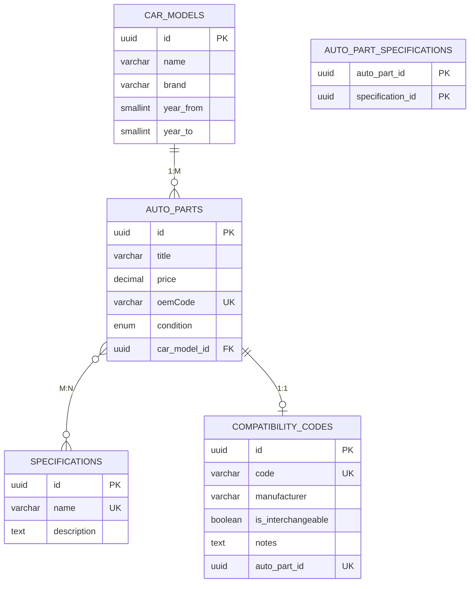

Зв'язок `AUTO_PARTS` з `CAR_MODELS` має зовнішній ключ `car_model_id` з `ON DELETE CASCADE`. Проміжна таблиця `AUTO_PART_SPECIFICATIONS` містить складений первинний ключ і два зовнішні ключі з каскадним видаленням. Таблиця `COMPATIBILITY_CODES` тримає унікальний `auto_part_id`, тому кожній запчастині відповідає не більше одного OEM-коду.
